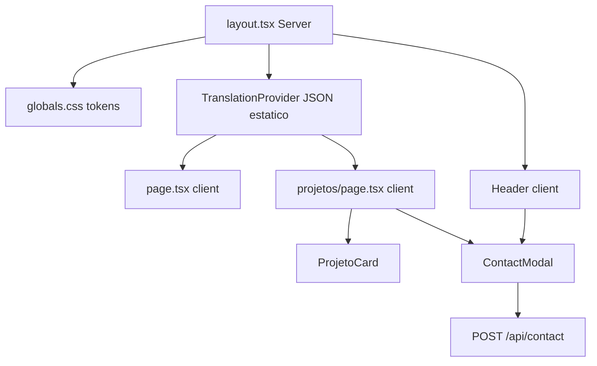

# 04 — Arquitetura

O redesign não muda o tipo de sistema. Continua um frontend Next.js com um proxy de contato. Este documento é o alvo. O mapa do código de hoje está em [../architecture/OVERVIEW.md](../architecture/OVERVIEW.md).

## O que permanece

- App Router em `src/`.
- `src/app/layout.tsx` Server Component, dono de `TranslationProvider` e `Header`.
- Páginas que usam `useTranslations` continuam com `'use client'`. Não partir a página em Server Component nesta rodada.
- i18n por contexto e JSON. Locale em `localStorage`. Sem `next-intl` e sem rota `/pt` ou `/en`.
- Projetos estáticos em `src/data/projetos.ts`. Textos em `messages/`.
- Tipo `ProjetoData` exportado por `src/components/ProjetoCard.tsx`. Não inverter.
- `ProjetoCard` pode continuar importando `src/app/projetos/projetos.module.css` nas fases 4 e seguintes. Mover o CSS só se a fase pedir e o import for atualizado no mesmo passo.
- `POST /api/contact` com `{ name, telephone }`. `API_URL` e `API_KEY` só em `src/app/api/contact/route.ts`.
- Dois `ContactModal` com estado separado. Não criar contexto de UI para unificar.
- CSS Modules. Sem Tailwind.
- Imports relativos.
- `src/middleware.ts` intocado.
- `next-intl` permanece instalado e sem uso.
- Assets órfãos em `public/` permanecem. Não referenciar e não apagar.
- URLs `/` e `/projetos`. PDF em `/curriculo/Curriculo - Rudio.pdf`.

## O que muda, por fase

- Tokens novos só em `:root` de `src/app/globals.css`.
- Botão compartilhado: `src/components/button.module.css`, importado onde o mesmo botão se repete. Não é pasta `ui/` nem design system em pacote.
- Motion, só na fase 6: `src/components/Reveal.tsx` se home e projetos precisarem do mesmo observer. Sem pasta `hooks`, sem provider.
- Fontes: tirar o `@import` do Google. `body` usa `var(--font-geist-sans)`.
- Imagens: `sizes` explícito. `priority` só na foto da home.

## Idioma sem skeleton inicial

`TranslationProvider` passa a importar os dois JSON de forma estática:

- `messages/pt.json`
- `messages/en.json`

Estado inicial: `locale = 'pt'`, `isLoading = false`, `t()` lê o cache no primeiro render. No `useEffect`, se `localStorage.locale` for `en` ou `pt`, atualizar o estado. Outro valor é ignorado. Quem salvou inglês pode ver português por um frame. Isso é aceito.

Não dynamic `import()` dos JSON. Os arquivos são pequenos.

`changeLocale` só aceita `'pt' | 'en'`.

As páginas podem manter o ramo `isLoading` enquanto ele for inalcançável. Não é obrigatório apagar skeleton na fase 1. É obrigatório que o primeiro render já tenha o texto em português.

## `lang`

O layout continua `<html lang="pt">` no servidor (o padrão do produto). Na fase 10, o provider faz `document.documentElement.lang = locale` quando o locale muda, inclusive na leitura do `localStorage`. O layout não vira Client Component.

## Arquivos por fase

Fase 0, esta documentação, não altera `src/`.

### Fase 1 — design system

Pode alterar:

- `src/app/globals.css`
- `src/app/layout.tsx` (só aplicação da variável de fonte no `body`; Geist já é carregado)
- `src/contexts/TranslationContext.tsx`
- `src/components/button.module.css` (novo)
- CSS Modules existentes só para trocar `font-family: 'Montserrat'` pela variável Geist e cores hardcodadas de botão que passem a usar o module compartilhado, sem mover blocos de layout

Não alterar nesta fase: composição da home, header visual completo (isso é a fase 3), lista de projetos, contrato da API, `messages/` (salvo se um token de texto for inevitável; não é).

Quando a fase 1 for implementada, acrescentar um ADR em `docs/decisions/` registrando: tema escuro fixo, fim da inversão de `prefers-color-scheme`, Geist visível. Atualizar a linha de consequência em `docs/decisions/0005-css-modules.md` que manda não inverter aquele media query. Atualizar `docs/features/` e `docs/changelog/CHANGELOG.md` porque o tema e a fonte visível mudam.

### Fase 2 — hero

Pode alterar:

- `src/app/page.tsx`
- `src/app/page.module.css`
- `messages/pt.json` e `messages/en.json` só nas chaves `home.eyebrow`, `home.work`, `home.portraitAlt`
- `src/components/button.module.css` se o CTA ainda não usar o botão da fase 1

Não alterar: `projetos.ts` (a faixa usa as keys que já existem), route de contato, Header (fase 3), textos de projeto, assets órfãos.

### Fase 3 — navegação

Pode alterar:

- `src/components/Header.tsx`
- `src/components/Header.module.css`
- `src/app/globals.css` só se faltar token de header (`--header-bg`, z-index)
- `src/app/page.tsx` se o CTA ainda for `<a>` em vez de `next/link`
- `messages/pt.json` e `messages/en.json`: valor de `navigation.about`; chaves do skip link
- `src/app/layout.tsx` só se o skip link precisar de um alvo `id` em `<main>` que o layout não controla. Preferir `id="conteudo"` no `<main>` de cada página (fase 2 e 3)

Não alterar: modal por dentro (fase 5), lista de projetos, middleware.

### Fase 4 — projetos

Pode alterar:

- `src/app/projetos/page.tsx`
- `src/app/projetos/projetos.module.css`
- `src/components/ProjetoCard.tsx`
- `src/data/projetos.ts` só se for preciso um campo já existente (`destaque` pode permanecer `true` no dado; a UI deixa de mostrar o badge)

Não alterar: textos dos parágrafos, não adicionar projeto, não apontar para `brunelly.png`, `cecis.png`, `cybergallery.png`, `refeicoes.png`, `tarefas.png` ou `img-rudio.png`. Não mudar `github`, `demo` nem `tipo`.

`id` de cada case = `key`.

### Fase 5 — modal

Pode alterar:

- `src/components/ContactModal.tsx`
- `src/components/ContactModal.module.css`
- `messages/pt.json` e `messages/en.json` só para `aria` que hoje está hardcoded, se a chave ainda não existir (fechar, rótulos de erro já existem)

Não alterar: `src/app/api/contact/route.ts`, nomes `name` e `telephone`, validação do servidor, unificação dos dois estados.

### Fase 6 — motion

Pode alterar:

- `src/components/Reveal.tsx` (novo, se preciso)
- `src/app/page.tsx`, `src/app/page.module.css`
- `src/app/projetos/page.tsx` ou `ProjetoCard.tsx` e o CSS de projetos
- `src/app/globals.css` só para o bloco `prefers-reduced-motion` se a fase 1 não tiver fechado

Não adicionar dependência. Não animar o header entre rotas.

### Fase 7 — microinterações

Só o que [03-MOTION-SYSTEM.md](03-MOTION-SYSTEM.md) lista como P0 e P1 e que as fases 1–5 não tenham coberto. Não criar cursor. Se não houver sobra, a fase é verificação e não diff.

### Fase 8

Não executar. Não criar branch de efeito avançado.

### Fase 9 — performance

Pode alterar props de `next/image` na home e nos cases, e o CSS que force tamanho com `!important`. Não adicionar loader. Não converter PNG órfão. Não instalar analyzer como dependência de produção. Um ensaio local com ferramenta já existente no ambiente pode ser feito sem commitar config permanente; se `next.config.ts` precisar de opção, justificar no changelog.

### Fase 10 — acessibilidade restante

Pode alterar: provider (`lang`), modal (se a fase 5 deixou aria incompleto), contraste de meta 12px se a medição falhar, metadata e Open Graph em `layout.tsx` usando a foto já usada na home (`/guilherme-rudio.png`). Sem imagem OG nova desenhada.

### Fase 11

Sem feature nova. Correções do que o QA visual mostrar, dentro dos docs. Ver [10-AI-DLC.md](10-AI-DLC.md).

### Fase 12

Itens da lista de micro-polish em [01-AUDIT.md](01-AUDIT.md) que ainda estiverem no código. Não refatorar vizinho.

## Proibido em todas as fases

- Camada `services`, `repositories`, `domain`, `dto`, `hooks` global.
- `next-intl`.
- GSAP, Lenis, Framer Motion, Motion, Three.js.
- Texto de biografia, métrica, cargo, empresa ou case que não esteja nos JSON antes da fase.
- Apagar asset, chave de tradução ou classe “porque parece sem uso”, fora o que a fase nomeia (Montserrat no CSS, `.highlight` se a fase 1 ou 12 estiver removendo CSS morto que ela mesma deixou de referenciar, carrossel).
- Mudar o contrato do contato.
- Client component novo para o layout inteiro.
- Alias `@/` em arquivo que já usa import relativo.

## Documentação quando o código mudar

Cada fase de código que altere comportamento, aparência ou contrato visível atualiza:

- o `docs/features/` da feature tocada;
- o topo de `docs/changelog/CHANGELOG.md`;
- um ADR só na fase 1, para a decisão de tema e fonte.

A fase 0 (estes arquivos) não leva changelog de produto: o comportamento do site não mudou.
